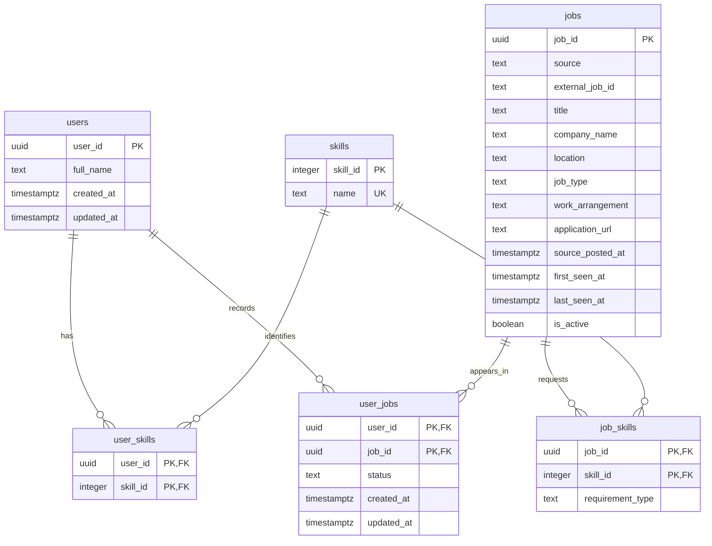

# MVP data model

Baseline approved 9 September 2026; updated 25 October 2026. `001` and the `002` skill
seed (139 skills) are applied to the development Supabase project. Migration `003`
(views, triggers, indexes) is planned under WP-1 in [PRD.md](PRD.md) — see the end of
this file. Tables and columns below are unchanged by 003.

The runnable Supabase bootstrap is [DB/001_initial_schema.sql](DB/001_initial_schema.sql).
See [DB/README.md](DB/README.md) for application instructions and verification limits.

## PostgreSQL

| Table | Fields and types | Keys and rules |
|---|---|---|
| users | user_id UUID; full_name text; created_at timestamptz; updated_at timestamptz | PK user_id; FK to auth.users.id; all required. Google sign-in through Supabase Auth. |
| skills | skill_id integer; name text | Generated PK skill_id; required name, case-insensitive unique. Synonyms need application normalization. |
| user_skills | user_id UUID; skill_id integer | Composite PK (user_id, skill_id); FKs to users and skills. Both required. |
| jobs | job_id UUID; source text; external_job_id text; title text; company_name text; location text; job_type text; work_arrangement text; application_url text; source_posted_at timestamptz; first_seen_at timestamptz; last_seen_at timestamptz; is_active boolean | PK job_id; unique (source, external_job_id). location, job_type, work_arrangement and source_posted_at may be null; other fields required. is_active defaults true. |
| job_skills | job_id UUID; skill_id integer; requirement_type text | Composite PK (job_id, skill_id); FKs to jobs and skills; all required. requirement_type is REQUIRED or PREFERRED. |
| user_jobs | user_id UUID; job_id UUID; status text; created_at timestamptz; updated_at timestamptz | Composite PK (user_id, job_id); FKs to users and jobs; all required. |

job_type: FULL_TIME, PART_TIME, INTERNSHIP. An internship is INTERNSHIP even if full-time.
work_arrangement: ONSITE, HYBRID, REMOTE.
user_jobs.status: NOT_INTERESTED, SAVED, APPLIED, INTERVIEW, REJECTED, OFFER.

created_at/first_seen_at are creation timestamps; updated_at/last_seen_at must be maintained
by application writes (or a later agreed trigger). A default timestamp alone does not update itself.

The junction tables implement users↔skills, jobs↔skills and users↔jobs many-to-many
relationships. Each link references exactly one existing row on either side. A parent
can have zero or many links. The bootstrap uses ON DELETE RESTRICT for every FK;
account deletion and cross-database cleanup flows remain to be designed.

## MongoDB

Bootstrap: [DB/001_initial_collections.js](DB/001_initial_collections.js), run in mongosh.
See [DB/README.md](DB/README.md#mongodb) for BSON types and application responsibilities.

### resume_documents

| Field | Type | Rule/purpose |
|---|---|---|
| _id | ObjectId | Document primary key |
| user_id | String UUID | Unique; logical reference to SQL users.user_id |
| file_name | String | Original filename only; not a downloadable file reference |
| raw_text | String | Extracted resume text |
| extracted_data | Object | skills array; education, experience and projects arrays of objects |
| uploaded_at | Date | Current upload timestamp |

A user has zero or one current document. A new upload replaces it. Extracted skills are
suggestions; confirmed edits live in SQL user_skills. No history or original PDF retention.

### job_documents

| Field | Type | Rule/purpose |
|---|---|---|
| _id | ObjectId | Document primary key |
| job_id | String UUID | Unique; logical reference to SQL jobs.job_id |
| raw_jd | String | Original description text |
| extracted_data | Object | role_category string; requirements array; responsibilities string array |
| extracted_at | Date | Current extraction timestamp |

Each normalized requirement contains skill_id (SQL integer reference), requirement_type
(REQUIRED/PREFERRED), minimum_years (number or null) and evidence (JD wording).
The LLM extracts names/evidence; application normalization assigns actual skill IDs.
Do not infer missing years or silently force ambiguous requirement strength; agree an
unknown/validation policy before extraction implementation.

A job has zero or one document during ingestion and exactly one current document when
ready for matching. The application must manage readiness and recovery; ordinary MongoDB
references do not enforce SQL foreign keys or a transaction spanning both databases.

Proposed role-gap query: obtain relevant active job IDs from SQL, aggregate their MongoDB
requirements by canonical skill, then compare with the student's confirmed SQL skill IDs.
Count a skill once per eligible job; expose the denominator. This avoids copying active
status into documents just to support filtering. Reassess if dataset size changes.

## Rules tied to product behaviour

- Every saved or not-interested decision has one user_jobs row; any such row excludes
  the listing from that user's discovery feed. No requeue and no separate swipes table.
- Browser batching affects request timing, not this relational structure. Latest-decision
  ordering, retries and account isolation need implementation-level tests.
- (source, external_job_id) prevents repeated imports from one provider; it does not solve
  cross-provider duplicates or reposts using new IDs.
- An absent job in one API page is not evidence of closure.
- Match scores are user-dependent; do not put a global score on jobs.
- Google sign-in through Supabase Auth is agreed. All application-data access goes
  through Python. Token verification, deletion flows and cross-store recovery remain
  implementation work before real student data is accepted.

## Migration 003 — views, triggers, indexes

File: `DB/003_views_triggers_indexes.sql`, applied after `001` in one transaction. It adds
database objects only; no table or column changes, so the ER diagram above stays valid.

- **`set_updated_at()`** is a trigger function that stamps `updated_at = now()`. It is
  attached as `users_set_updated_at` (on `users`) and `user_jobs_set_updated_at` (on
  `user_jobs`), both `BEFORE UPDATE ... FOR EACH ROW WHEN (OLD.* IS DISTINCT FROM NEW.*)`.
  An update that changes nothing therefore leaves `updated_at` untouched, and Python no
  longer has to maintain the column.
- **`user_jobs_requires_active_job`** is a `BEFORE INSERT` trigger on `user_jobs` (function
  `user_jobs_require_active_job()`). It is the project's non-standard integrity constraint:
  a CHECK cannot look at another table, so the trigger raises `check_violation` (SQLSTATE
  23514) when the referenced job is missing or not `is_active`. Only genuinely new rows are
  guarded: if a row for the same user and job already exists, the insert is let through
  (PostgreSQL fires the trigger before it detects ON CONFLICT), so an upsert on an existing
  row whose job was deactivated later still works as an update.
- **`v_job_requirement_counts(job_id, required_total, preferred_total)`** counts each active
  job's `REQUIRED` and `PREFERRED` rows in `job_skills` using `COUNT(*) FILTER`. Inactive
  jobs, and jobs with no skill rows, do not appear. No app route reads it: Discover needs
  per-user matched counts, so it aggregates `job_skills` itself. It is there for report and
  analytics queries.
- **`v_user_tracker_summary(user_id, status, job_count)`** counts a user's `user_jobs` rows
  per status. Statuses with no rows do not appear.
- **Indexes.** `jobs_active_type_arrangement_idx` on `jobs (job_type, work_arrangement)` and
  `jobs_active_posted_at_idx` on `jobs (source_posted_at DESC)` are partial (`WHERE
  is_active`), so they stay small and serve the Discover filters and ordering.
  `user_jobs_user_status_idx` on `user_jobs (user_id, status)` serves tracker tabs and the
  summary view.
- **Access.** Both views follow 001's model: all privileges revoked from
  `PUBLIC`/`anon`/`authenticated`, `SELECT` granted to `service_role`.

### Design notes from the 2026-10-26 review

Three findings from the overnight build, each with the test that pins it. They are worth
quoting in the final report's integrity-constraint discussion.

1. **A BEFORE INSERT trigger runs before ON CONFLICT.** The first version of
   `user_jobs_requires_active_job` rejected every insert for an inactive job. The tracker's
   `INSERT ... ON CONFLICT (user_id, job_id) DO UPDATE` is an insert attempt, and PostgreSQL
   fires BEFORE INSERT row triggers before it detects the conflict. So a student who had
   saved a job that was later deactivated could not move it from SAVED to APPLIED. The
   trigger now lets the insert through when the `(user_id, job_id)` row already exists, so
   only genuinely new rows are guarded. A concurrent DELETE plus upsert can still slip past
   (noted in the SQL comment). Tests in `backend/tests/test_sql_003.py`:
   `test_upsert_existing_row_of_deactivated_job_changes_status`,
   `test_upsert_same_status_on_deactivated_job_keeps_updated_at` and
   `test_upsert_new_row_for_inactive_job_is_check_violation`.
2. **One rule, two engines: REQUIRED beats PREFERRED.** When a job lists the same skill
   twice, PRD §4 says REQUIRED wins. MongoDB's skill-gap pipeline applies it with
   `$group` by `{job_id, skill_id}` and `$max` of `(type == REQUIRED ? 1 : 0)`. SQL's
   `_replace_job_skills` applies it with
   `ON CONFLICT ... SET requirement_type = CASE WHEN job_skills.requirement_type = 'REQUIRED'
   THEN 'REQUIRED' ELSE EXCLUDED.requirement_type END`. The SQL side was last-wins until the
   review. `test_engines_agree_when_links_come_from_production_sync`
   (`backend/tests/test_skill_gap_db.py`) writes links the production way and checks that both
   engines report the same required count.
3. **A read path should depend only on the store it reads.** Discover reads PostgreSQL only,
   but its first version used a dependency that also opened MongoDB, so it returned 503
   whenever MongoDB was unset or down. It now takes auth and the shared job lock without
   MongoDB. `test_real_lock_reaches_the_store_without_mongo` and `test_real_lock_busy_is_503`
   (`backend/tests/test_discover.py`).
